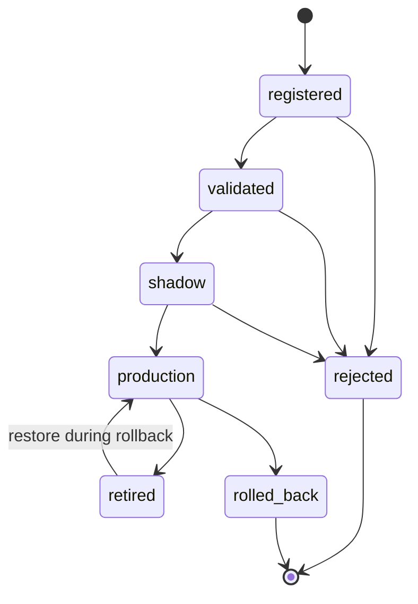
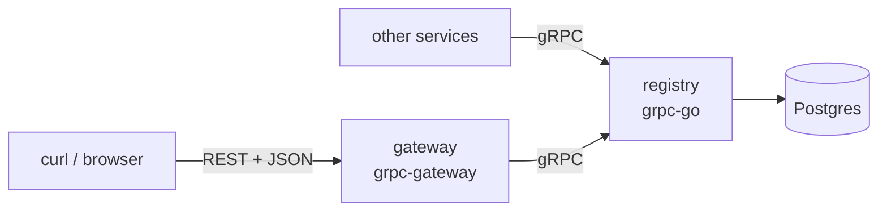
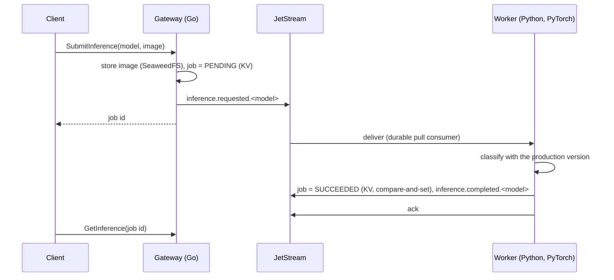

# Spotter

A small, cloud-neutral platform for deploying and monitoring computer-vision models on overhead imagery. Register a model version, serve it behind REST and gRPC, run inference through an event bus, watch live traffic for drift, retrain, shadow-test the new version, and promote it through code-checked gates and a human approval, with rollback.

Status: the registry, its API, a trained EuroSAT model, and event-driven inference are built. The sections below grow as each part is built.

## Model registry

A model version moves through a fixed set of stages. Only these transitions exist; everything else is rejected:



- **One production version per model,** enforced by a partial unique index in Postgres, not just by application code.
- **Optimistic concurrency:** every transition states the revision it expects. When two race, exactly one wins; the other gets a conflict.
- **Transactional outbox:** every registration and stage change writes a protobuf event ([registry_events.proto](proto/spotter/v1/registry_events.proto)) in the same transaction as the change.
- **Hexagonal and checked:** `domain`, `ports`, and `app` can't import infrastructure; a test fails the build if they do. The Postgres and in-memory repositories pass one shared contract suite, including the concurrency scenarios.
- **Kubernetes-ready process:** config from environment variables, migrations at startup, `/livez` and `/readyz`, graceful shutdown on SIGTERM.

Specs: [model-registry](openspec/specs/model-registry/spec.md), [model-lifecycle](openspec/specs/model-lifecycle/spec.md), [registry-service](openspec/specs/registry-service/spec.md).

## API

One file, [registry.proto](proto/spotter/v1/registry.proto), defines the gRPC service, its REST paths, and the [OpenAPI document](gen/openapi/v2/spotter/v1/registry.swagger.json) ([0007](docs/decisions/0007-grpc-go-with-grpc-gateway.md)).



- The registry serves gRPC with the standard health service and reflection; the gateway translates REST to gRPC and serves `/openapi.json`.
- Every registry error maps to one gRPC code (and one HTTP status at the gateway). Validation errors name the field: `400 {"code":3, "details":[{"fieldViolations":[{"field":"artifact_sha256",…}]}]}`.
- The gateway's `/readyz` checks the registry's gRPC health, so a gateway with no registry gets no traffic.

Specs: [registry-api](openspec/specs/registry-api/spec.md), [gateway-http](openspec/specs/gateway-http/spec.md).

## The model

A small CNN (three conv blocks, about 0.3 M parameters) trained from scratch on EuroSAT RGB (27,000 64×64 Sentinel-2 tiles, 10 land-use classes), on a laptop CPU.

| Measured (one run, seed 42) | Result |
|---|---|
| Holdout accuracy (4,050 tiles never seen in training) | **96.57%** |
| Holdout macro F1 | 0.964 |
| Weakest classes (recall) | PermanentCrop 93.3%, River 93.6%, Pasture 94.0% |
| Most common confusion | PermanentCrop predicted as HerbaceousVegetation (13 of 375) |
| Training time (12 epochs, CPU, PyTorch 2.15) | 18 min |

- **Splits are deterministic and stratified** (70/15/15 per class); the split's fingerprint is recorded with the model. The holdout set is read once, after training; a test checks nothing reads it earlier.
- **Artifacts are content-addressed:** `s3://models/<model>/<sha256>/model.pt`, with a `metadata.json` beside it (split fingerprint, seed, hyperparameters, commit, library versions, metrics) ([0008](docs/decisions/0008-content-addressed-model-artifacts.md)).
- **Registration and validation are code:** the trainer registers the version over gRPC with its holdout metrics and moves it to `validated` only if accuracy meets a configured floor (0.85).

Specs: [training-data](openspec/specs/training-data/spec.md), [model-evaluation](openspec/specs/model-evaluation/spec.md), [model-publishing](openspec/specs/model-publishing/spec.md).

## Event-driven inference

Clients submit an image and get a job id back immediately; a Python worker picks the job up from NATS JetStream and records the result.



- **At-least-once, one result per job** ([0009](docs/decisions/0009-at-least-once-inference-with-kv-job-state.md)): the worker records a result only if the job is still `PENDING` (compare-and-set on the KV revision), publishes the completion with a de-duplicating message id, and acks only after both. Tests stop the worker before it acks and before it records; the job still ends with exactly one result and one completion event.
- **Retries and dead letters:** transient failures are retried with a delay; undecodable requests, undecodable images, and jobs on their last delivery are recorded `FAILED` and published to `inference.failed.<model>`.
- **The worker serves the production version only,** verifies the artifact's SHA-256 against the registry before loading it, and reloads when a version enters or leaves production (it follows `registry.events.model_version_stage_changed`).
- **The registry's outbox is published** to JetStream in order, each record once per message id, and marked published only after the server acknowledges it.
- **Streams are code:** `internal/natsjs` is the one definition of the streams and bucket; services apply it at startup, and `spotterctl setup` applies it for tools and CI.

First end-to-end run: version 1 promoted to production through the REST API, then 20 holdout tiles (2 per class) through `spotterctl infer`: **20/20 correct**, 20 requests and 20 completions on the stream, no redeliveries.

Specs: [event-streams](openspec/specs/event-streams/spec.md), [inference-api](openspec/specs/inference-api/spec.md), [inference-processing](openspec/specs/inference-processing/spec.md).

## Observability

One trace follows a request across every process and the message bus ([0010](docs/decisions/0010-opentelemetry-traces-prometheus-metrics.md)). From Jaeger, for one image:

```
+  0.0 ms   53.7 ms  gateway           spotter.v1.InferenceService/SubmitInference
+  0.0 ms    1.3 ms  gateway           spotter.v1.RegistryService/GetModel  (client)
+  0.0 ms    1.3 ms  registry          spotter.v1.RegistryService/GetModel  (server)
+ 53.1 ms    0.5 ms  gateway           publish inference.requested.eurosat-classifier
+ 54.5 ms   15.2 ms  inference-worker  process inference.requested
+ 55.3 ms    5.4 ms  inference-worker    download image
+ 60.8 ms    4.9 ms  inference-worker    classify
+ 65.9 ms    1.6 ms  inference-worker    record result
+ 67.6 ms    1.2 ms  inference-worker    publish inference.completed.eurosat-classifier
```

- **W3C trace context** travels over gRPC and HTTP (standard instrumentation) and over NATS in message headers (`internal/natstrace`).
- **The trace survives the outbox:** a registry change stores the active `traceparent` with its outbox record, and the relay attaches it when it publishes, so "operator promoted version 2" and "worker reloaded" land in one trace.
- **Spans hold ids, versions, outcomes, and sizes, never image bytes or credentials**; a test records every span of a submission and checks.
- **Prometheus metrics** at `/metrics` on every service: gRPC and HTTP request rate and duration, the worker's jobs by outcome, model time, and its consumer's pending messages.
- Export is on when `OTEL_EXPORTER_OTLP_ENDPOINT` is set; otherwise tracing is a no-op that still propagates context. Locally, Jaeger is at http://localhost:16686 and Prometheus at http://localhost:9090.

Spec: [observability](openspec/specs/observability/spec.md).

## Optimization and load tests

`spotter-optimize` exports a registered PyTorch version to ONNX, checks it against PyTorch on every holdout tile, quantizes it to int8 (static, per-channel, calibrated on training tiles), measures each variant, and registers the variants as new versions with their parent recorded ([0011](docs/decisions/0011-onnx-runtime-static-int8.md)). A quantized version is validated only if it loses at most 0.01 holdout accuracy.

| Variant (4 threads) | Size | Holdout accuracy | p50, batch 1 | Images/s, batch 32 |
|---|---|---|---|---|
| PyTorch fp32 (v1) | 1,143 KB | 96.57% | 1.98 ms | 645 |
| ONNX fp32 (v2) | 1,157 KB | 96.57% | 0.81 ms | 1,282 |
| ONNX int8 (v3) | 320 KB | 96.54% | **0.43 ms** | **3,011** |

ONNX fp32 matches PyTorch to 1.25e-6 in probability with no disagreeing predictions. Full report: [benchmarks/2026-11-22-model-variants.md](benchmarks/2026-11-22-model-variants.md).

**End to end it's a different story** ([load tests](benchmarks/2026-11-22-load-tests.md)). `spotterload` (Go) drives the gateway and times each job from submission to its completion event. With 4 closed-loop clients, v1 and v3 both deliver about 60 jobs/s at a p50 of 64–67 ms: the model is about 3 ms of a 65 ms job. Jaeger spans show where the rest goes: **writing the image to the object store takes 50 of the 66 ms submit call**. A second worker didn't add throughput for the same reason. The next lever is the submit path (keep ~3 KB tiles inline instead of in the object store), not the model.

Specs: [model-optimization](openspec/specs/model-optimization/spec.md), [load-testing](openspec/specs/load-testing/spec.md).

## Architecture

- **Go services:** registry (model versions and their lifecycle), gateway (REST and gRPC front door), monitor (drift detection). Each is hexagonal: domain and use-case code depend only on ports, and Postgres, NATS, and S3 sit behind adapters.
- **Python workers:** inference (PyTorch / ONNX Runtime) and trainer.
- **NATS JetStream** carries jobs and events, at least once, with idempotent consumers.
- **PostgreSQL** for the registry and monitoring data. **SeaweedFS** (S3 API) for images and model artifacts.
- **Kubernetes** via Helm; k3d and Tilt locally, kind in CI.

## How it is built

Spec-driven, one change at a time:

- Each change is an [OpenSpec](openspec/) change: proposal, requirements with WHEN/THEN scenarios, design, and tasks, archived once done.
- Decisions that outlive a change get a [decision record](docs/decisions/).
- Every test names the requirement it verifies, in Go, Python, and TypeScript ([0001](docs/decisions/0001-adopt-openspec-with-cross-language-traceability.md)).

## Run it

Requirements: Docker Desktop, Go 1.27+, [uv](https://docs.astral.sh/uv/), and [buf](https://buf.build/) (only to regenerate code).

```bash
cp .env.example .env
docker compose up -d --wait        # Postgres, NATS JetStream, SeaweedFS (S3 on :8333)
uv sync
```

Check that Go and Python reach each other through NATS:

```bash
uv run spotter-inference           # terminal 1: the Python worker
go run ./cmd/spotterctl ping       # terminal 2: reply from inference-worker (python 3.13.x) in 1.6ms
```

Run the registry (it migrates on start), the gateway, and the worker, each in its own terminal with the `.env` values loaded (`set -a; . ./.env; set +a`):

```bash
HTTP_ADDR=:8081 go run ./services/registry/cmd/registry
REGISTRY_ADDR=localhost:9090 go run ./services/gateway/cmd/gateway
REGISTRY_ADDR=localhost:9090 uv run spotter-inference

curl localhost:8080/v1/models/eurosat-classifier/versions
```

Promote a validated version to production (`expectedRevision` is the version's current revision), then classify images:

```bash
curl -X POST localhost:8080/v1/versions/<id>:transition -d '{"toStage":"MODEL_VERSION_STAGE_SHADOW","reason":"shadow","expectedRevision":"2"}'
curl -X POST localhost:8080/v1/versions/<id>:transition -d '{"toStage":"MODEL_VERSION_STAGE_PRODUCTION","reason":"promote","expectedRevision":"3"}'
go run ./cmd/spotterctl infer data/eurosat/2750/Forest/Forest_1.jpg
```

Train a model and register it (downloads EuroSAT, about 94 MB, into `data/`):

```bash
set -a; . ./.env; set +a
REGISTRY_ADDR=localhost:9090 uv run spotter-train
```

## Test

```bash
go test ./...                      # Go; Postgres tests start their own container. CI adds -race (needs cgo)
go run gotest.tools/gotestsum@v1.13.0 --jsonfile go-test.json -- ./... && go run ./tools/speccheck
                                   # every spec requirement has a passing linked test
uv run pytest                      # Python; integration tests need NATS_URL=nats://localhost:4222
uv run ruff check . && uv run ruff format --check .
buf lint && buf generate           # generated code is committed; CI fails if it is stale
```

## Data

EuroSAT (public Sentinel-2 land-use tiles) plus synthetic degradations. No restricted or sensitive data.
