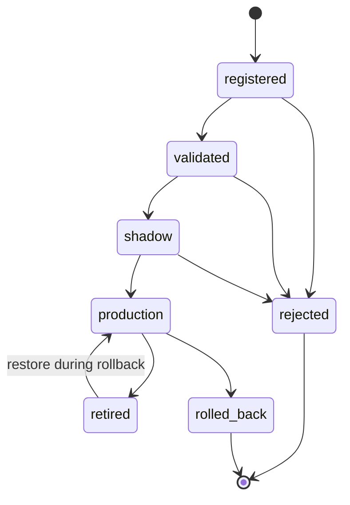
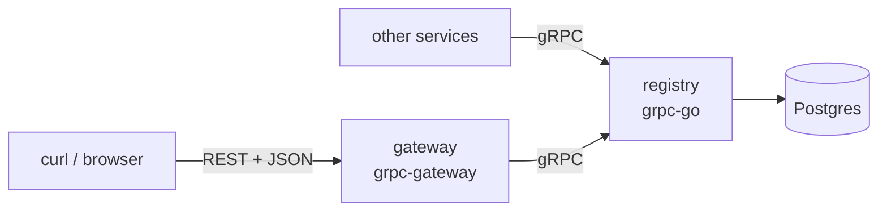
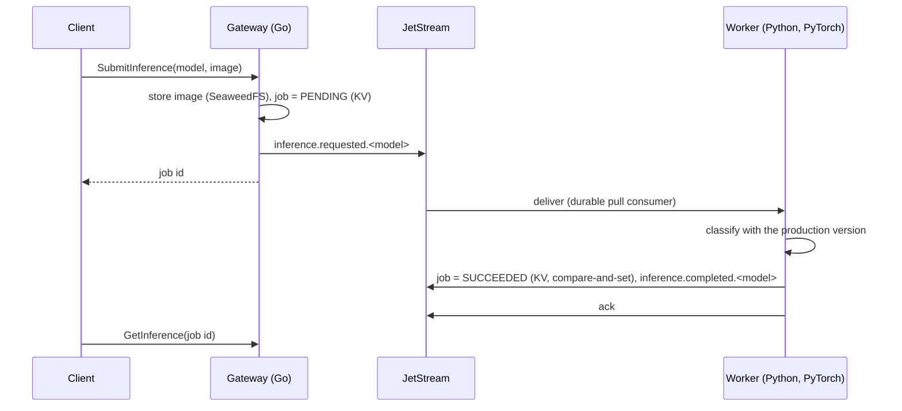

# Spotter

A small, cloud-neutral platform for deploying and monitoring computer-vision models on overhead imagery. Register a model version, serve it behind REST and gRPC, run inference through an event bus, watch live traffic for drift, retrain, shadow-test the new version, and promote it through code-checked gates and a human approval, with rollback.

Status: registry and API, a trained EuroSAT model, event-driven inference, tracing and metrics, optimized model variants with load tests, drift monitoring, shadow testing with gated promotion and rollback, and Kubernetes deployment are built. The dashboard comes next.

## Model registry

A model version moves through a fixed set of stages. Only these transitions exist; everything else is rejected:



- **One production version per model,** enforced by a partial unique index in Postgres, not just by application code.
- **Optimistic concurrency:** every transition states the revision it expects. When two race, exactly one wins; the other gets a conflict.
- **Transactional outbox:** every registration and stage change writes a protobuf event ([registry_events.proto](proto/spotter/v1/registry_events.proto)) in the same transaction as the change.
- **Hexagonal and checked:** `domain`, `ports`, and `app` can't import infrastructure; a test fails the build if they do. The Postgres and in-memory repositories pass one shared contract suite, including the concurrency scenarios.
- **Kubernetes-ready process:** config from environment variables, migrations at startup, `/livez` and `/readyz`, graceful shutdown on SIGTERM.

Specs: [model-registry](openspec/specs/model-registry/spec.md), [model-lifecycle](openspec/specs/model-lifecycle/spec.md), [registry-service](openspec/specs/registry-service/spec.md).

## API

One file, [registry.proto](proto/spotter/v1/registry.proto), defines the gRPC service, its REST paths, and the [OpenAPI document](gen/openapi/v2/spotter/v1/registry.swagger.json) ([0007](docs/decisions/0007-grpc-go-with-grpc-gateway.md)).



- The registry serves gRPC with the standard health service and reflection; the gateway translates REST to gRPC and serves `/openapi.json`.
- Every registry error maps to one gRPC code (and one HTTP status at the gateway). Validation errors name the field: `400 {"code":3, "details":[{"fieldViolations":[{"field":"artifact_sha256",…}]}]}`.
- The gateway's `/readyz` checks the registry's gRPC health, so a gateway with no registry gets no traffic.

Specs: [registry-api](openspec/specs/registry-api/spec.md), [gateway-http](openspec/specs/gateway-http/spec.md).

## The model

A small CNN (three conv blocks, about 0.3 M parameters) trained from scratch on EuroSAT RGB (27,000 64×64 Sentinel-2 tiles, 10 land-use classes), on a laptop CPU.

| Measured (one run, seed 42) | Result |
|---|---|
| Holdout accuracy (4,050 tiles never seen in training) | **96.57%** |
| Holdout macro F1 | 0.964 |
| Weakest classes (recall) | PermanentCrop 93.3%, River 93.6%, Pasture 94.0% |
| Most common confusion | PermanentCrop predicted as HerbaceousVegetation (13 of 375) |
| Training time (12 epochs, CPU, PyTorch 2.15) | 18 min |

- **Splits are deterministic and stratified** (70/15/15 per class); the split's fingerprint is recorded with the model. The holdout set is read once, after training; a test checks nothing reads it earlier.
- **Artifacts are content-addressed:** `s3://models/<model>/<sha256>/model.pt`, with a `metadata.json` beside it (split fingerprint, seed, hyperparameters, commit, library versions, metrics) ([0008](docs/decisions/0008-content-addressed-model-artifacts.md)).
- **Registration and validation are code:** the trainer registers the version over gRPC with its holdout metrics and moves it to `validated` only if accuracy meets a configured floor (0.85).

Specs: [training-data](openspec/specs/training-data/spec.md), [model-evaluation](openspec/specs/model-evaluation/spec.md), [model-publishing](openspec/specs/model-publishing/spec.md).

## Event-driven inference

Clients submit an image and get a job id back immediately; a Python worker picks the job up from NATS JetStream and records the result.



- **At-least-once, one result per job** ([0009](docs/decisions/0009-at-least-once-inference-with-kv-job-state.md)): the worker records a result only if the job is still `PENDING` (compare-and-set on the KV revision), publishes the completion with a de-duplicating message id, and acks only after both. Tests stop the worker before it acks and before it records; the job still ends with exactly one result and one completion event.
- **Retries and dead letters:** transient failures are retried with a delay; undecodable requests, undecodable images, and jobs on their last delivery are recorded `FAILED` and published to `inference.failed.<model>`.
- **The worker serves the production version,** verifies the artifact's SHA-256 against the registry before loading it, and reloads when a version enters or leaves production (it follows `registry.events.model_version_stage_changed`). It also runs the newest shadow version, if any, without letting it affect results (see [promotion](#promotion-and-rollback)).
- **The registry's outbox is published** to JetStream in order, each record once per message id, and marked published only after the server acknowledges it.
- **Streams are code:** `internal/natsjs` is the one definition of the streams and bucket; services apply it at startup, and `spotterctl setup` applies it for tools and CI.

First end-to-end run: version 1 promoted to production through the REST API, then 20 holdout tiles (2 per class) through `spotterctl infer`: **20/20 correct**, 20 requests and 20 completions on the stream, no redeliveries.

Specs: [event-streams](openspec/specs/event-streams/spec.md), [inference-api](openspec/specs/inference-api/spec.md), [inference-processing](openspec/specs/inference-processing/spec.md).

## Observability

One trace follows a request across every process and the message bus ([0010](docs/decisions/0010-opentelemetry-traces-prometheus-metrics.md)). From Jaeger, for one image:

```
+  0.0 ms   53.7 ms  gateway           spotter.v1.InferenceService/SubmitInference
+  0.0 ms    1.3 ms  gateway           spotter.v1.RegistryService/GetModel  (client)
+  0.0 ms    1.3 ms  registry          spotter.v1.RegistryService/GetModel  (server)
+ 53.1 ms    0.5 ms  gateway           publish inference.requested.eurosat-classifier
+ 54.5 ms   15.2 ms  inference-worker  process inference.requested
+ 55.3 ms    5.4 ms  inference-worker    download image
+ 60.8 ms    4.9 ms  inference-worker    classify
+ 65.9 ms    1.6 ms  inference-worker    record result
+ 67.6 ms    1.2 ms  inference-worker    publish inference.completed.eurosat-classifier
```

- **W3C trace context** travels over gRPC and HTTP (standard instrumentation) and over NATS in message headers (`internal/natstrace`).
- **The trace survives the outbox:** a registry change stores the active `traceparent` with its outbox record, and the relay attaches it when it publishes, so "operator promoted version 2" and "worker reloaded" land in one trace.
- **Spans hold ids, versions, outcomes, and sizes, never image bytes or credentials**; a test records every span of a submission and checks.
- **Prometheus metrics** at `/metrics` on every service: gRPC and HTTP request rate and duration, the worker's jobs by outcome, model time, and its consumer's pending messages.
- Export is on when `OTEL_EXPORTER_OTLP_ENDPOINT` is set; otherwise tracing is a no-op that still propagates context. Locally, Jaeger is at http://localhost:16686 and Prometheus at http://localhost:9099.

Spec: [observability](openspec/specs/observability/spec.md).

## Optimization and load tests

`spotter-optimize` exports a registered PyTorch version to ONNX, checks it against PyTorch on every holdout tile, quantizes it to int8 (static, per-channel, calibrated on training tiles), measures each variant, and registers the variants as new versions with their parent recorded ([0011](docs/decisions/0011-onnx-runtime-static-int8.md)). A quantized version is validated only if it loses at most 0.01 holdout accuracy.

| Variant (4 threads) | Size | Holdout accuracy | p50, batch 1 | Images/s, batch 32 |
|---|---|---|---|---|
| PyTorch fp32 (v1) | 1,143 KB | 96.57% | 1.98 ms | 645 |
| ONNX fp32 (v2) | 1,157 KB | 96.57% | 0.81 ms | 1,282 |
| ONNX int8 (v3) | 320 KB | 96.54% | **0.43 ms** | **3,011** |

ONNX fp32 matches PyTorch to 1.25e-6 in probability with no disagreeing predictions. Full report: [benchmarks/2026-11-22-model-variants.md](benchmarks/2026-11-22-model-variants.md).

**End to end it's a different story** ([load tests](benchmarks/2026-11-22-load-tests.md)). `spotterload` (Go) drives the gateway and times each job from submission to its completion event. With 4 closed-loop clients, v1 and v3 both deliver about 60 jobs/s at a p50 of 64–67 ms: the model is about 3 ms of a 65 ms job. Jaeger spans show where the rest goes: **writing the image to the object store takes 50 of the 66 ms submit call**. A second worker didn't add throughput for the same reason. The next lever is the submit path (keep ~3 KB tiles inline instead of in the object store), not the model.

Specs: [model-optimization](openspec/specs/model-optimization/spec.md), [load-testing](openspec/specs/load-testing/spec.md).

## Drift monitoring

The monitor (Go) watches every `InferenceCompleted` event and compares a sliding window of the last 200 per model version with that version's **training-time reference**: per-image channel brightness, contrast, and model confidence over the validation split, stored as `reference.json` beside the artifact and computed exactly as the worker computes them ([0012](docs/decisions/0012-drift-detection-psi-against-training-reference.md)).

- **PSI** per feature every 50 events; `DriftDetected` when any feature reaches 0.2, `DriftResolved` when all fall below 0.1, published once per change on the `MONITOR` stream. The KS statistic and p-value ride along as evidence. PSI per feature is a Prometheus gauge.
- PSI has a noise floor: with 10 bins and 200 events, identical distributions give about 0.047 on average (measured 0.051), which is why 0.2/0.1 rather than anything tighter.

Measured against the live stack with `spotter-degrade` ([report](benchmarks/2026-11-22-drift-detection.md)):

| Clean traffic | Darken | Haze | Noise | Blur |
|---|---|---|---|---|
| **0 false alarms** in 3,000 events | detected in 64–144 events | 124–150 | 62–161 | 167–215 at radius ≥ 1 px; **mild blur (0.5 px) not detected** |

Darkening and haze move the brightness features; noise and blur mostly move the model's confidence. Mild blur would need a sharpness feature.

Spec: [drift-monitoring](openspec/specs/drift-monitoring/spec.md).

## Promotion and rollback

A new version earns production on real traffic, through gates that are plain code, with a person's recorded approval ([0013](docs/decisions/0013-gated-promotion-shadow-traffic-human-approval.md)).

- **Shadow:** while a version is in `shadow`, the worker classifies every job with it too, after the job is acknowledged, and publishes `ShadowCompared` (both labels, agreement, both model times) on `inference.shadow.<model>`. Results and completion events come from production only, and a failing shadow model never changes a job's outcome.
- **Statistics:** the registry consumes the comparisons and stores one row per job, so a redelivered event is counted once.
- **Gates:** `accuracy` (holdout ≥ production − 0.01), `shadow_agreement` (≥ 200 comparisons, ≥ 95% agreement), `shadow_latency` (mean ≤ 25 ms), and `approval` (≥ 1 recorded approval with name and reason). `GET /v1/versions/{id}/gates` shows each with its reason. A model's first version has nothing to be compared with, so its accuracy and shadow gates pass and say so, and the approval decides ([0015](docs/decisions/0015-first-promotion-without-shadow-evidence.md)).
- **Atomic swap:** `POST /v1/versions/{id}:promote` retires the current production version and promotes the candidate in one transaction, with both history entries and both events. `POST /v1/models/{name}:rollback` marks production `rolled_back` and restores the version most recently retired from production, also in one transaction. There is never zero or two production versions, and the generic transition endpoint refuses `production`.

Measured on the live stack ([report](benchmarks/2026-11-22-promotion-run.md)), shadowing fp32 v2 against int8 v3 in production:

| Shadow agreement | Promote → worker serving | Rollback → worker serving | Rollback under load |
|---|---|---|---|
| **99.9%** (818 of 819 jobs) | 232 ms | 457 ms | 496 jobs, **0 failed, 0 lost** |

The run also exposed a worker problem: with two ONNX Runtime sessions, the default per-core thread pools busy-waited across 16 cores and slowed every service on the host to 7.5 jobs/s. Single-threaded models without spinning fixed it (43 jobs/s while shadowing, 63–65 without).

Specs: [model-promotion](openspec/specs/model-promotion/spec.md), [shadow-inference](openspec/specs/shadow-inference/spec.md).

## Retraining on drift

`spotter-retrain` closes the loop: it fine-tunes the newest PyTorch version with the drift experiment's degradations (blur, noise, haze, darken) added to training, measures it on the clean and degraded holdout, and takes it as far as **shadow**, never further ([0018](docs/decisions/0018-retrain-by-fine-tuning-with-synthetic-degradations.md)). `spotter-retrain --watch` runs once per `DriftDetected` event; the chart can run it as a Job or as a watcher Deployment.

Measured on the live stack ([report](benchmarks/2026-11-22-retraining.md)): hazed traffic raised drift on version 3 in 3.4 s, the watcher started retraining 3.6 s later, and version 4 was in shadow 7 minutes after the drift began, with no one involved. Its holdout accuracy:

| Holdout | Version 1 (parent) | Version 4 (retrained) |
|---|---|---|
| Clean | 96.57% | 95.58% |
| Haze | 22.32% | **87.80%** |
| Darken | 31.28% | **88.86%** |
| Blur | 24.54% | **75.19%** |
| Noise | 11.14% | **64.47%** |

After clean traffic every gate passed except the approval (592 comparisons, 98.5% agreement), so a person decides.

Spec: [model-retraining](openspec/specs/model-retraining/spec.md).

## Kubernetes

One Helm chart, [`deploy/helm/spotter`](deploy/helm/spotter), declares the platform ([0014](docs/decisions/0014-helm-umbrella-chart-keda-scaling.md)): registry, gateway, monitor, and worker Deployments; Postgres and SeaweedFS StatefulSets; NATS with JetStream from the official chart, vendored so installs work offline; and an optional trainer Job.

- **Two images:** one distroless image with every Go binary, one slim image with the Python workspace (CPU PyTorch). Both run as non-root users with read-only root filesystems.
- **Credentials** are generated into a Secret at first install and kept on upgrade; workloads read them only through `secretKeyRef`. A test renders the chart and fails if a credential shows up in a ConfigMap or a literal value.
- **Health and shutdown:** every container has probes and CPU/memory requests and limits; Go services get a grace period longer than their `SHUTDOWN_TIMEOUT`, and the worker's `MODEL_THREADS` follows its CPU limit. Init containers run `spotterctl wait` so services start after their dependencies listen.
- **Autoscaling on backlog:** KEDA scales the worker on the lag of its JetStream consumer, not on CPU.
- **Checked:** `helm test` runs `spotterctl smoke` (gateway and registry ready, a model registered and read back over REST, the worker answers a NATS ping). CI installs the chart into kind and runs it.

Measured on k3d ([report](benchmarks/2026-11-22-kubernetes.md)):

| Empty cluster → all ready (`tilt ci`) | Spike, 64 clients for 90 s | Scale up | Scale down |
|---|---|---|---|
| 7 min 29 s, 0 restarts | **188.7 jobs/s** with KEDA (1 → 3 workers) vs 78.3 with one worker; 0 failed, 0 lost | 3 workers ready 18 s after the spike started | back to 1 worker 18 s after the load ended |

Installing into an empty cluster found two real bugs: the Go image's named user failed `runAsNonRoot`, and a model's first version could never be promoted, because the worker can't shadow without a production version ([0015](docs/decisions/0015-first-promotion-without-shadow-evidence.md)).

Spec: [platform-deployment](openspec/specs/platform-deployment/spec.md).

## Architecture

- **Go services:** registry (model versions and their lifecycle), gateway (REST and gRPC front door), monitor (drift detection). Each is hexagonal: domain and use-case code depend only on ports, and Postgres, NATS, and S3 sit behind adapters.
- **Python workers:** inference (PyTorch / ONNX Runtime) and trainer.
- **NATS JetStream** carries jobs and events, at least once, with idempotent consumers.
- **PostgreSQL** for the registry and monitoring data. **SeaweedFS** (S3 API) for images and model artifacts.
- **Kubernetes** via Helm; k3d and Tilt locally, kind in CI.

## How it is built

Spec-driven, one change at a time:

- Each change is an [OpenSpec](openspec/) change: proposal, requirements with WHEN/THEN scenarios, design, and tasks, archived once done.
- Decisions that outlive a change get a [decision record](docs/decisions/).
- Every test names the requirement it verifies, in Go, Python, and TypeScript ([0001](docs/decisions/0001-adopt-openspec-with-cross-language-traceability.md)).

## Run it

Requirements: Docker Desktop, Go 1.27+, [uv](https://docs.astral.sh/uv/), and [buf](https://buf.build/) (only to regenerate code).

**On Kubernetes** (also needs [k3d](https://k3d.io/), [Tilt](https://tilt.dev/), Helm, and kubectl):

```bash
k3d cluster create --config deploy/k3d/cluster.yaml   # one node plus a local image registry
tilt up                                               # builds images, installs KEDA and the chart
helm test spotter -n spotter                          # end-to-end smoke test
```

k3d makes the new cluster your current kube context unless you pass `--kubeconfig-switch-context=false` (then run `tilt up --context k3d-spotter`). Tilt forwards the gateway to `localhost:8080` (REST) and `:9091` (gRPC), and NATS to `:4222`.

**On the host,** with only the dependencies in Docker:

```bash
cp .env.example .env
docker compose up -d --wait        # Postgres, NATS JetStream, SeaweedFS (S3 on :8333)
uv sync
```

Check that Go and Python reach each other through NATS:

```bash
uv run spotter-inference           # terminal 1: the Python worker
go run ./cmd/spotterctl ping       # terminal 2: reply from inference-worker (python 3.13.x) in 1.6ms
```

Run the registry (it migrates on start), the gateway, and the worker, each in its own terminal with the `.env` values loaded (`set -a; . ./.env; set +a`):

```bash
HTTP_ADDR=:8081 go run ./services/registry/cmd/registry
REGISTRY_ADDR=localhost:9090 go run ./services/gateway/cmd/gateway
REGISTRY_ADDR=localhost:9090 uv run spotter-inference

curl localhost:8080/v1/models/eurosat-classifier/versions
```

Put a validated version into shadow (`expectedRevision` is the version's current revision), send traffic, check its gates, approve it, and promote it; roll back if needed:

```bash
curl -X POST localhost:8080/v1/versions/<id>:transition -d '{"toStage":"MODEL_VERSION_STAGE_SHADOW","reason":"shadow","expectedRevision":"2"}'
go run ./cmd/spotterctl infer data/eurosat/2750/Forest/Forest_1.jpg
curl localhost:8080/v1/versions/<id>/gates
curl -X POST localhost:8080/v1/versions/<id>:approve -d '{"approver":"<name>","reason":"<why>"}'
curl -X POST localhost:8080/v1/versions/<id>:promote -d '{}'
curl -X POST localhost:8080/v1/models/eurosat-classifier:rollback -d '{"reason":"<why>"}'
```

Train a model and register it (downloads EuroSAT, about 94 MB, into `data/`):

```bash
set -a; . ./.env; set +a
REGISTRY_ADDR=localhost:9090 uv run spotter-train
```

## Test

```bash
go test ./...                      # Go; Postgres tests start their own container. CI adds -race (needs cgo)
go run gotest.tools/gotestsum@v1.13.0 --jsonfile go-test.json -- ./... && go run ./tools/speccheck
                                   # every spec requirement has a passing linked test
uv run pytest                      # Python; integration tests need NATS_URL=nats://localhost:4222
uv run ruff check . && uv run ruff format --check .
buf lint && buf generate           # generated code is committed; CI fails if it is stale
```

## Data

EuroSAT (public Sentinel-2 land-use tiles) plus synthetic degradations. No restricted or sensitive data.
