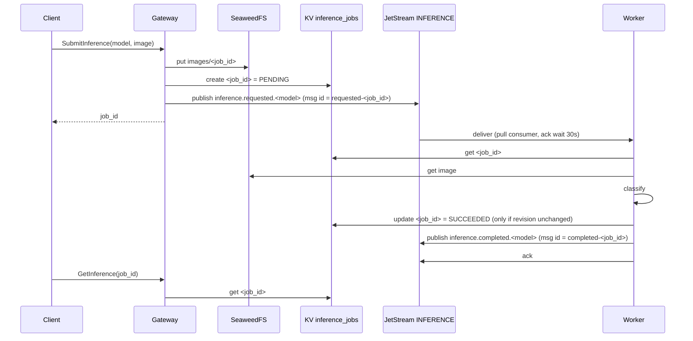

# Design

## Context

The registry writes events to an outbox (change `phase-01-registry-domain`); there is a trained, registered model (change `phase-03-model-training`); NATS JetStream and SeaweedFS run locally (decision records [0003](../../../../docs/decisions/0003-object-store-seaweedfs.md), [0004](../../../../docs/decisions/0004-local-dev-topology.md)). Delivery semantics are recorded in decision record [0009](../../../../docs/decisions/0009-at-least-once-inference-with-kv-job-state.md).

## Flow

## Decisions

### D1. Streams are declared in one Go package
`internal/natsjs.Ensure(ctx, js)` creates or updates `INFERENCE` (subjects `inference.>`, file storage, 24 h max age, 2 min duplicate window), `REGISTRY` (`registry.events.>`, 7 days, 2 min window), and KV bucket `inference_jobs` (24 h TTL). The registry and the gateway call it at startup; it is idempotent. Each consumer declares its own durable consumer in its own code (the worker's is `inference-worker`, filter `inference.requested.>`, explicit ack, ack wait 30 s, max deliver 5).

### D2. Job state lives in JetStream KV, not a database
The gateway would otherwise need its own Postgres schema just to hold job status. KV gives compare-and-set by revision, which is exactly what "record a result only if still PENDING" needs. Results expire after 24 hours; the drift monitor will consume the completion events, not the KV.

### D3. One result per job: compare-and-set, then publish with a per-kind message id
Message ids are `requested-<job_id>`, `completed-<job_id>`, and `failed-<job_id>`. The three kinds share the `INFERENCE` stream's duplicate window, so a bare job id would make the stream drop the completion as a duplicate of the request; the first integration test caught exactly that.

The worker reads the job's KV entry. If it's already final, this is a redelivery: re-publish the completion (the stream drops it as a duplicate within the window) and ack. Otherwise it classifies, updates the entry with the revision it read (a second worker racing on the same job fails the update and takes the duplicate path), publishes, and acks. Every crash point leaves the job either still `PENDING` (it will be redelivered and done) or final with its event published or re-publishable.

### D4. Ack, nak with delay, term
- **ack** after the result is recorded and the event published.
- **nak with a 5 s delay** for transient failures: no production model loaded, object store or KV errors.
- **term** (no redelivery) for poison messages: undecodable event or image, or the last allowed delivery. Before terminating, the worker records `FAILED` (when the job id is known) and publishes `InferenceFailed` on `inference.failed.<model>`, which the `INFERENCE` stream retains as the dead-letter record.

### D5. The registry relay is a use case plus a NATS adapter
`app.Service.RelayOutbox(ctx, limit)` reads pending records, publishes each through a `ports.EventPublisher`, and marks the published ones with `Repository.MarkPublished`. It stops at the first failure so order is kept. The NATS adapter sets `Nats-Msg-Id` to the record id and waits for the publish acknowledgement. `cmd/registry` runs the relay every 500 ms until shutdown.

### D6. Model loading verifies the checksum, then swaps atomically
The worker asks the registry (gRPC `ListVersions`) for the production version, downloads the artifact, compares SHA-256 with the registered checksum, loads the weights with `torch.load(weights_only=True)` into `EuroSATNet`, and swaps the loaded model in one assignment. A separate subscription to `registry.events.model_version_stage_changed` triggers a reload when a version of its model enters or leaves production.

### D7. The gateway grows a hexagon
`services/gateway/internal/{domain,ports,app,adapters}`: the domain validates submissions; the app's `Submit` stores the image, creates the job, and publishes; adapters wrap S3, NATS, and KV. The gRPC `InferenceService` server is a driving adapter; REST comes from registering the same server with grpc-gateway in process (no network hop). An `archtest` like the registry's guards the boundaries.

### D8. Tests use real infrastructure
Go: an embedded JetStream server (nats-server as a library) per test, and a SeaweedFS container started once per test binary. Python: the Compose NATS and SeaweedFS, plus an in-process fake registry gRPC server and a small randomly initialised model artifact. The crash scenarios use a 1 s ack wait so redelivery happens within a test.

## Risks and trade-offs

- **Duplicate suppression lasts two minutes.** A completion re-published after the window would be stored twice; consumers of `inference.completed` must also be idempotent (they key on the job id).
- **KV TTL drops results after 24 hours.** Accepted: job status is short-lived; history comes from the event stream.
- **No streaming of results.** Clients poll `GetInference`; `spotterctl infer` polls every 200 ms.
